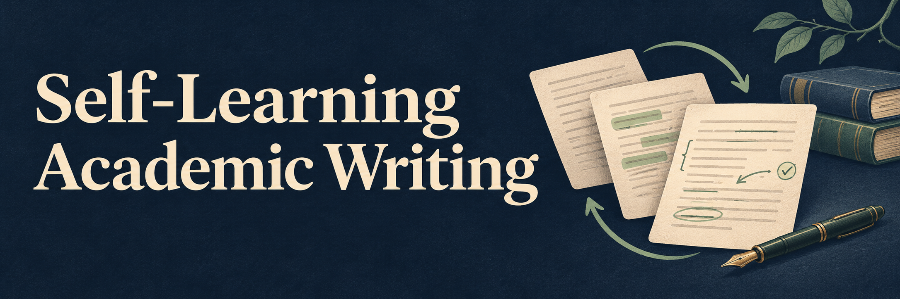

[English](README.md) · [简体中文](README.zh.md)

# Self-Learning Academic Writing

An Agent Skill for Chinese- and English-language journals. It studies the papers you choose, from the overall argument down to individual sentence patterns. It combines what it learns with your evidence and intended argument, then proposes a section outline before drafting. It can also edit existing manuscripts or translate Chinese into concise academic English when explicitly requested.

**Pick up where you left off.** On first use in your manuscript folder, the skill creates two Markdown files: [`references.md`](references/reference-library.md) for the example papers, local copies, and notes by section, and [`writing-preferences.md`](references/writing-profile.md) for confirmed project preferences. Open the same folder to reuse them in another session. Save a preference to a separate local author profile when you want it to carry over to other manuscripts.

## What it does

| Capability | How it works |
| --- | --- |
| Study reference papers | Examine the paper's argument, the target section's role, paragraph transitions, grammar, wording, and concision. Record traceable source excerpts. |
| Adapt sentences from example papers | Reuse a sentence’s grammatical structure or a conventional phrase that serves the same purpose. Fill the frame with your own research, and fit it to the surrounding text. |
| Keep a reference library | Automatically create a `references.md` index with local source copies and notes organized by paper and section. Reuse them across sessions in the same workspace. |
| Draft by section | Work on the abstract, introduction, literature review, methods, data, results, discussion, or conclusion. Present a plan and wait for an explicit start. |
| Write or revise summaries | Read the complete results of each example paper and of the author's study before planning an abstract or conclusion. Select findings that answer the research questions and preserve the limits of the evidence. |
| Edit existing text | Polish Chinese or English, including text translated elsewhere. Remove stock phrasing, trim details the context already establishes, and keep references to key terms precise. Preserve the author's meaning, facts, citations, terminology, and claim strength. |
| Translate on request | Translate selected paragraphs one at a time or assemble a complete English manuscript. Check terminology and coverage. |
| Resume work and save preferences | Switch between sections without losing earlier plans, drafts, or revisions. Save personal preferences with the author's confirmation. |

## Quick start

1. Clone the repository or download and extract the GitHub ZIP. Keep the entire `self-learning-academic-writing` directory.

```sh
git clone https://github.com/AAA111-STA/self-learning-academic-writing.git
```

2. Install using your host's entry below. If your host can read files, you can also point it to [SKILL.md](SKILL.md) in the full directory. In a text-only chat, paste the [portable chat edition](references/portable-chat.en.md).
3. The full workflow needs Python 3.9+ and local file access. Give the agent the target section, output language, example papers or relevant excerpts with context, and your research materials.
4. Review the outline or revision plan, then explicitly tell the agent to start. An installed hook can receive the instruction in chat. Hosts without the hook can use terminal confirmation.

## Agent compatibility

Skill discovery and chat hooks are separate capabilities. The native adapters listed below receive submitted user instructions. The terminal path works on hosts with local Python, and the portable edition can be pasted into a text-only chat.

| Agent | Install or load the directory | Confirmation path |
| --- | --- | --- |
| Codex | Project `.agents/skills/` or load from this checkout | Native hook or terminal |
| Claude Code | Project `.claude/skills/` | Native hook or terminal |
| Qwen Code | Project `.qwen/skills/` | Native hook using declared user submissions, or terminal |
| Kimi Code CLI | A directory from its [Agent Skills documentation](https://www.kimi.com/code/docs/en/kimi-code-cli/customization/skills.html) | Native hook or terminal |
| ZCode | User `~/.zcode/skills/`, then refresh Skills in Settings | Native hook or terminal |
| Google Gemini CLI | `gemini skills install https://github.com/AAA111-STA/self-learning-academic-writing.git` | Optional status hook; authorize via terminal or a trusted generic integration |
| Google Antigravity | Project `.agents/skills/` | Native hook or terminal |
| Tencent WorkBuddy | Upload a local skill package in Skills | Terminal with local Python, otherwise chat confirmation |
| DeepSeek Harness | Project `.dsh/skills/` or `.agents/skills/` | Optional bridge status hook; authorize via terminal or a trusted generic integration |
| TRAE | Project `.trae/skills/` | Terminal or generic integration |
| OpenCode | Project `.opencode/skills/` | Terminal or generic integration |
| Other agents | Import the directory, read `SKILL.md`, or use the portable chat edition | Generic integration, terminal, or chat according to host capabilities |

See [Agent setup and hook configuration](references/agent-hooks.md) for optional setup and the official documentation. `user-confirm` and `profile-confirm` also work when you choose terminal confirmation.

## Example requests

> Use self-learning-academic-writing. Study the discussion sections of these papers and save useful sentence frames for comparing findings, and outline my Discussion using the results I supplied. Wait for “Start writing.”

> Polish this draft for an English-language journal. Propose edits first and preserve the meaning and data.

> Translate this paragraph into English: …

> Translate the whole manuscript into English.

> Whenever I compare models, I want to state the validation conditions. Prepare that as a writing preference for me to confirm.

## Files and local data

- [SKILL.md](SKILL.md) contains the writing and revision rules. [Workflow reference](references/workflow-inputs.md) describes the commands and input formats.
- Drafts, reference notes, and confirmed project preferences stay under the project's `.self-learning-academic-writing/` folder and are ignored by Git by default. Confirmed [personal profiles](references/writing-profile.md) are stored locally in the user's home directory by default.
- The [project reference library](references/reference-library.md) keeps local sources and section notes available when you move to another section or session.
- From the repository root, run `python -m unittest discover -s tests` to check section recovery, preference confirmation, language workflows, and hook adapters.

## Third-party notices

The repository includes the unmodified guide and [MIT license](references/vendor/academic-humanizer/LICENSE) of [academic-humanizer](https://github.com/AIScientists-Dev/academic-humanizer) v0.3.3 by AIScientists-Dev.

The editing and translation guides adapt paragraph and evidence checks from Master-cai's [Research Paper Writing Skills](https://github.com/Master-cai/Research-Paper-Writing-Skills), based on Prof. Peng Sida's study notes, under the [MIT license](references/vendor/research-paper-writing/LICENSE).
