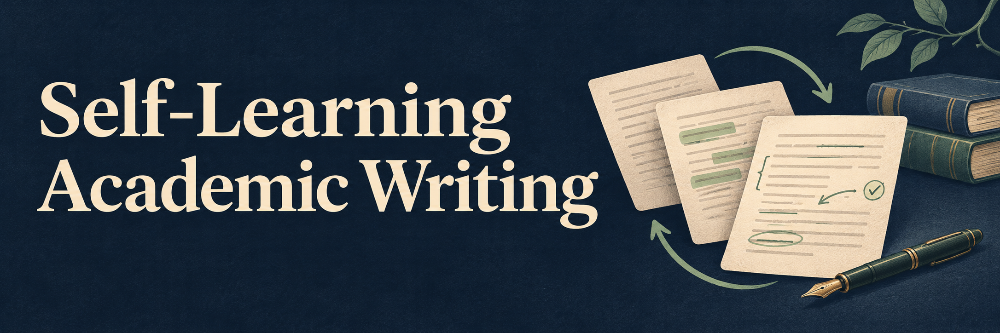

[English](README.md) · [简体中文](README.zh.md)

# Self-Learning Academic Writing

面向中文和英文期刊的学术写作 Skill。它先学习你指定的范文，从全文论证读到具体句式，再把适用的写法和你的研究材料、论证思路结合起来。你可以先看提纲，明确发出指令后再起草正文，也可以润色已有稿件或按需英译。

**换个聊天也能接着写。** 首次在论文目录使用时，Skill 自动创建两份 Markdown：[`references.md`](references/reference-library.md) 记录范文、原文副本入口和按章节整理的笔记；[`writing-preferences.md`](references/writing-profile.md) 记录你确认过的项目写作习惯。换会话时打开同一个论文目录即可复用，想带到下一篇论文的通用习惯可以另存到本机个人档案。

## 能做什么

| 功能 | 具体做法 |
| --- | --- |
| 学习指定范文 | 分析全文论证、目标章节的职责、段落推进、语法、措辞和简洁表达。学习记录使用可定位的原文例子。 |
| 仿写句子 | 同一表达任务可以直接沿用范文的句法骨架和常用学术表达。填入自己的研究对象、条件和结果，并按前后文调整。 |
| 项目参考文献库 | 默认建一份 `references.md`，集中记录作者提供的文献、原文副本入口和按章整理的学习内容，换会话可从同一项目复用。 |
| 按章节写作 | 覆盖摘要、引言、综述、方法、数据、结果、讨论和结论。先拟提纲，收到明确开写指令后生成正文。 |
| 每轮使用章节指南 | 提纲说明用了哪条内置结构规则，动笔前查对应句式并按稿件需要用。合并章节会分别使用各部分的指南。 |
| 写作或润色摘要与结论 | 拟提纲前通读每篇范文和用户研究的完整结果，选择能回答研究问题的关键发现，保留限制结论的证据。 |
| 润色现稿 | 支持中文、英文及其他软件翻好的英文稿。按授权范围修改。定稿时删去套话和重复说明，保留必要限定，检查简称和指代是否准确，并复核事实、数值、术语、引用和结论强度。 |
| 可选学术英译 | 明确要求后逐段或整篇翻译，统一术语、核对覆盖范围，使用简洁的学术英文。 |
| 保存版本和偏好 | 各章的提纲、稿件和返修历史可分别恢复。个人偏好经过确认才进入跨会话档案。 |

## 快速开始

1. 克隆仓库，或从 GitHub 下载并解压 ZIP。保留完整的 `self-learning-academic-writing` 目录。

```sh
git clone https://github.com/AAA111-STA/self-learning-academic-writing.git
```

2. 从下表选择安装入口。宿主没有 Skill 安装入口时，可以让它读取完整目录的 [SKILL.md](SKILL.md)。只支持聊天文字时，可以粘贴 [便携聊天版](references/portable-chat.md)。
3. 完整流程需要 Python 3.9+ 和本地文件访问。告诉智能体目标章节、输出语言，提供范文全文或相关章节与必要上下文，再提供你的研究材料。
4. 审阅提纲或润色方案后，下达明确指令。启用原生钩子时可在聊天中下达；采用终端确认时，智能体会给出对应命令。

## 兼容平台

Skill 加载和聊天钩子是两项能力。下表为已核对的入口。本项目提供的原生适配可从宿主接收用户指令，终端确认可以在能运行 Python 的宿主上使用。仅能聊天的宿主使用便携版。

| 平台 | 安装或加载完整目录 | 接收明确指令 |
| --- | --- | --- |
| Codex | 项目的 `.agents/skills/`，或从本仓库目录加载 | 原生钩子或终端 |
| Claude Code | 项目的 `.claude/skills/` | 原生钩子或终端 |
| Qwen Code | 项目的 `.qwen/skills/` | 原生钩子，读取带提交来源的用户文本，或终端 |
| Kimi Code CLI | 从 [Agent Skills](https://www.kimi.com/code/docs/en/kimi-code-cli/customization/skills.html) 指定的目录加载 | 原生钩子或终端 |
| 智谱 ZCode | 用户 `~/.zcode/skills/`，在设置中刷新技能 | 原生钩子或终端 |
| Google Gemini CLI | `gemini skills install https://github.com/AAA111-STA/self-learning-academic-writing.git` | 钩子可提示流程状态，授权用终端或可信通用接入 |
| Google Antigravity | 项目的 `.agents/skills/` | 原生钩子或终端 |
| 腾讯 WorkBuddy | 技能管理中上传本地技能包 | 有本地 Python 时用终端，否则用聊天确认 |
| DeepSeek Harness | 项目的 `.dsh/skills/` 或 `.agents/skills/` | 兼容桥钩子可提示状态，授权用终端或可信通用接入 |
| TRAE | 项目的 `.trae/skills/` | 终端或通用接入 |
| OpenCode | 项目的 `.opencode/skills/` | 终端或通用接入 |
| 其他智能体 | 导入完整目录、读取 `SKILL.md`，或使用便携聊天版 | 通用接入、终端或聊天确认，视宿主能力而定 |

配置步骤和官方文档见 [智能体接入与钩子](references/agent-hooks.md)。原生钩子可选，用户也可以在项目目录里用 `user-confirm` 或 `profile-confirm` 确认对应操作。

## 可以这样说

> 使用 self-learning-academic-writing。学习这两篇范文的讨论部分，保存适合比较研究结果的句式，再结合我给的结果列讨论提纲。等我说「开始写」再写正文。

> 按英文期刊的写法润色这版现稿，先给修改方案，保留原意和数据。

> 把下面这段翻译成英文：……

> 把这篇论文翻译成英文。

> 我希望以后比较模型表现都写明验证条件。请提炼成一条个人偏好，给我确认。

## 文件与隐私

- [SKILL.md](SKILL.md) 定义工作流程和各章节的写法，[运行门禁与输入](references/workflow-inputs.md) 说明命令和输入格式。
- 项目草稿、学习记录和已确认的项目偏好保存在论文目录的 `.self-learning-academic-writing/`，默认由 Git 忽略。[个人档案](references/writing-profile.md) 默认保存在本机用户目录。
- 同一论文的范文保存在 [项目参考文献库](references/reference-library.md)，换章节或换聊天时先查本地目录和已有原文。
- 在仓库根目录运行 `python -m unittest discover -s tests` 可核对章节恢复、偏好保存、语言模式及钩子。

## 第三方来源与许可

仓库随附 AIScientists-Dev 的 `academic-humanizer` v0.3.3 原始指南和 MIT 许可证。 [上游项目](https://github.com/AIScientists-Dev/academic-humanizer) · [随附许可](references/vendor/academic-humanizer/LICENSE)

润色和英译指南中的段落与证据检查参考 Master-cai 基于彭思达教授笔记整理的 [Research Paper Writing Skills](https://github.com/Master-cai/Research-Paper-Writing-Skills)。英译授权、范围和忠实性由本 Skill 的流程定义。 [随附许可](references/vendor/research-paper-writing/LICENSE)
